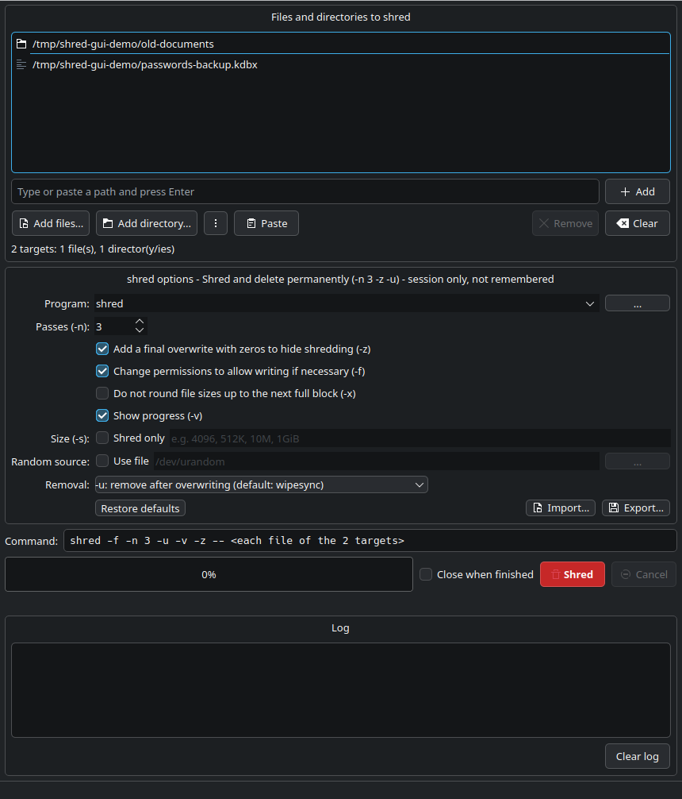
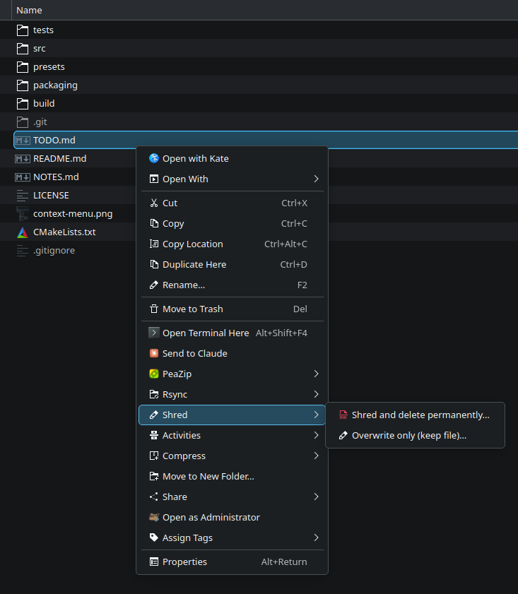
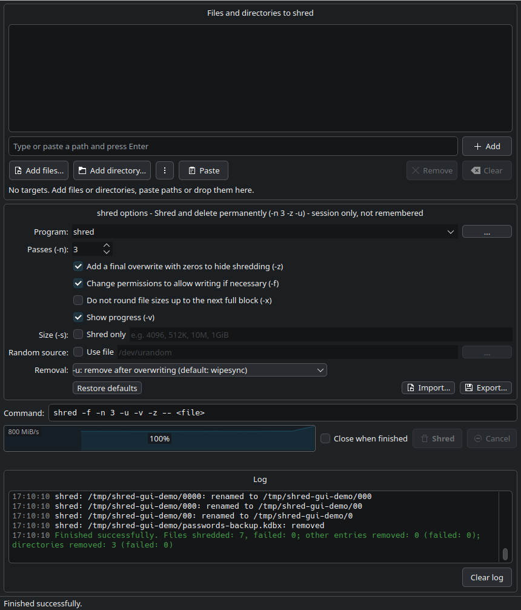
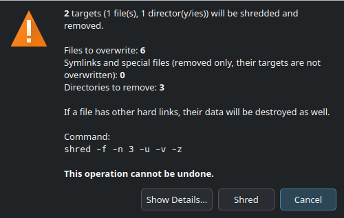

# Shred GUI

> **Created with AI.** The source code, tests and documentation of this project were written by an
> AI model — Claude (Anthropic) in Claude Code — following the author's requirements and decisions.
> The author directed the work and tested the application; the AI wrote the code and ran the automated
> tests. Commits made this way carry a `Co-Authored-By: Claude` line. Review the code before relying
> on it — shredding cannot be undone.

A Qt 6 graphical front-end for the `shred` command line tool from GNU coreutils / uutils.

- **target list** (files and directories): add with buttons, type/paste a path
  (also `file://...`, quoted, with `~`), paste many paths from the clipboard (`Ctrl+V`,
  including files copied in Dolphin), drag & drop from a file manager, paths on the command line,
- file names that are **not valid UTF-8** (e.g. Latin-1 names from old archives) are kept exactly
  and passed to `shred` as bytes; the window and the log show such bytes as `\xNN`,
- **directories are shredded recursively**: every file goes through `shred`, then the
  subdirectories are removed (deepest first) and finally the directory itself,
- access to **all `shred` options**: `-n`, `-z`, `-f`, `-x`, `-v`, `-s`, `--random-source`,
  `-u` and `--remove=unlink|wipe|wipesync`, choice of the program (`shred`, `gnushred`, any path),
- preview of the generated command, confirmation dialog with the list of files, progress bar
  (from the `-v` passes), log, cancellation,
- **progress outside the window** (KDE Plasma): on the task manager entry and as a job in the
  notification area (current file, speed, a cancel button, a summary at the end),
- options are remembered between runs; *Close when finished* quits the application after
  a fully successful run (after errors or cancelling the window stays open),
- export/import of the configuration to/from JSON files (*File → Export/Import settings*,
  *Export… / Import…* buttons),
- **presets** shipped with the application (`--preset`, *File → Load preset*) and integration
  with the **Dolphin** context menu (*Shred* submenu).



## Requirements

- Linux, Qt 6 (Core, Widgets, DBus; Test for the tests), CMake ≥ 3.19, a C++17 compiler
- `shred` (coreutils) — on Ubuntu 25.10+ `/usr/bin/shred` is the uutils (Rust) version
  and GNU shred is available as `gnushred`; both are supported.

Ubuntu / Debian:

```bash
sudo apt install build-essential cmake ninja-build qt6-base-dev
```

## Building

```bash
cmake -S . -B build -G Ninja -DCMAKE_BUILD_TYPE=Release
```

```bash
cmake --build build
```

Running (optionally with a list of paths, a preset or a settings file):

```bash
./build/shred-gui ~/to-shred ~/secret.txt
```

```bash
./build/shred-gui --preset shred-delete ~/to-shred
```

```bash
./build/shred-gui --config ~/shred-paranoid.json ~/secret.txt
```

```bash
./build/shred-gui --list-presets
```

Options loaded with `--preset` / `--config` (and from *File → Load preset*) apply **to the current
session only** — they do not overwrite the remembered options. The title of the options section
then shows "… - session only, not remembered". Only *Import settings…* changes them permanently.

Tests:

```bash
ctest --test-dir build --output-on-failure
```

System-wide installation (executable, `.desktop` entry, presets, Dolphin menu):

```bash
sudo cmake --install build
```

Or for the current user only, without root (into `~/.local/bin` and `~/.local/share`).
The `.desktop` files get the absolute path of the installed program, so Dolphin finds it even
before `~/.local/bin` is in `PATH`:

```bash
cmake --install build --prefix ~/.local
```

The Dolphin menu can be skipped with `cmake -S . -B build -DSHRED_GUI_INSTALL_SERVICEMENUS=OFF`.

Uninstalling (removes exactly the files listed by the last `cmake --install` from this build directory):

```bash
xargs -d '\n' rm -v < build/install_manifest.txt
```

Screenshots for this README (`docs/screenshots/shred-gui-*.png`) are generated by running the real
application with demo files in `/tmp/shred-gui-demo` (they are really shredded) and a temporary
configuration (the windows appear on the screen for a few seconds); the Dolphin menu screenshot is
taken by hand:

```bash
tools/make-screenshots.sh
```

## Presets

Installed into `<prefix>/share/shred-gui/presets/`:

| Preset | Name | Effect |
|---|---|---|
| `shred-delete` | Shred and delete permanently (-n 3 -z -u) | 3 passes, `-f`, `-z`, `-v`, removal with `-u` (wipesync) |
| `shred-overwrite` | Overwrite only, keep the file (-n 3 -z) | 3 passes, `-f`, `-z`, `-v`, no removal |

A preset is shown under the same name everywhere — in *File → Load preset*, in the title of the
options section and in the Dolphin menu: the `name` from its file followed by the options that
decide what is destroyed (`-n`, `-z`, `-s`, the removal mode). The tooltip in *Load preset* shows
the whole command and the file.

Presets do not set the program — the one chosen by the user (`shred`/`gnushred`) is kept.
They are searched for in this order: `~/.local/share/shred-gui/presets/`, the `$XDG_DATA_DIRS`
directories, `<program dir>/../share/shred-gui/presets/` and `<program dir>/presets/` (build).
A custom `~/.local/share/shred-gui/presets/shred-delete.json` overrides the shipped one;
you can also add your own presets (any `*.json` name, format as below).

## Dolphin context menu

After installation Dolphin shows a **Shred** submenu:



- **Shred and delete permanently (-n 3 -z -u)…** — files and directories (`--preset shred-delete`),
- **Overwrite only, keep the file (-n 3 -z)…** — files only (`--preset shred-overwrite`).

Clicking an entry opens Shred GUI with the selected items in the list and the preset loaded —
nothing happens automatically, you still have to click *Shred* and confirm. Several selected
items end up in one window. Only local files are supported.

If you used your own `shred` service menu before, remove it to avoid duplicated entries.
New entries usually appear immediately; if not, run `kbuildsycoca6`.

## Settings files (JSON)

Remembering the options between runs works independently (`~/.config/fapped/shred-gui.conf`).
In addition, the current options can be exported to a JSON file and imported later — e.g. a few
ready-made profiles (quick, paranoid, overwrite only). Options imported with
*Import settings…* become the new remembered options (unlike presets and `--config`).

```json
{
    "format": "shred-gui-settings",
    "version": 1,
    "name": "My settings",
    "options": {
        "program": "shred",
        "iterations": 3,
        "force": false,
        "verbose": true,
        "exact": false,
        "zero": true,
        "useSize": false,
        "size": "",
        "useRandomSource": false,
        "randomSource": "",
        "removeMode": "wipesync"
    }
}
```

- `removeMode`: `none`, `default` (`-u`), `unlink`, `wipe`, `wipesync`,
- `iterations`: an integer from 0 to 1000,
- `name` (optional) — the name shown in the window and in the log,
- keys missing from `options` keep the current values from the window (this is how presets
  skip `program`), unknown keys are ignored,
- a file with a value of the wrong type, an unknown `format` or a newer `version` is rejected
  as a whole (the options in the window stay unchanged).

## How shredding a directory works

1. Scanning (without following symlinks and without crossing into other file systems).
   Duplicates in the list and targets inside another directory from the list are skipped (the
   parent directory processes them); invalid targets (missing, symlinks, protected) can be skipped.
2. Every regular file: `shred <options> -- <file>` (one process per file).
3. Symlinks, FIFOs, sockets and device files inside the directory are only removed
   (`unlink`) — they are **not** passed to `shred`, because it would destroy the file the
   symlink points to (possibly outside the directory).
4. Empty directories are removed deepest first; in the `-u`, `wipe` and `wipesync` modes their
   names are obfuscated first (renamed to `000…0`, `00…0`, …, `0`), the same way `shred`
   does it for files.

Removing a directory requires removing its files — if "Do not remove" is selected, the
application offers to enable `-u`.



## Progress outside the window

While shredding runs, its progress is also shown

- on the Shred GUI entry in the task manager (the `com.canonical.Unity.LauncherEntry` D-Bus signal,
  supported by Plasma; the entry is matched by `shred-gui.desktop`, so it works for the installed
  application),
- as a job in the Plasma notification area (`org.kde.JobViewServerV2`): the target, the number of
  files and the amount to write (size × passes), the current file ("File 3 of 12: …"), percentage,
  and a button that cancels shredding. Under *Details* Plasma draws a **speed graph**; shred reports
  only whole passes (GNU shred also the progress of long passes), so the amount written is estimated
  from them and the speed is the average since the start. When the job ends, the notification shows
  a summary ("1,8 GiB written in 0:00:03", "Cancelled after …" or the error).

On other desktops or without a session bus this does nothing.

## Safeguards

- A target that is a symbolic link is rejected — select the real path instead.
- Recursive shredding of `/`, the home directory and the main system directories is refused.
- Mount points of other file systems inside a directory are skipped (and reported).
- A confirmation with the number of files and the command is always shown before starting
  (*Show Details…* lists the files):



## Limitations of `shred`

`shred` assumes that data is overwritten in place. On SSDs (wear leveling, TRIM), copy-on-write
file systems (btrfs, ZFS), with snapshots, compression, RAID, NFS or in backups the data may
survive. See `man shred` for details.

## AI disclosure

This project was created with AI assistance: all code, tests and documentation were generated by
Claude (Anthropic) via Claude Code, based on the author's instructions, and verified with the
automated tests in `tests/` and by manual checks. The notice is also shown in *Help → About*.

## License

MIT — see [LICENSE](LICENSE).
